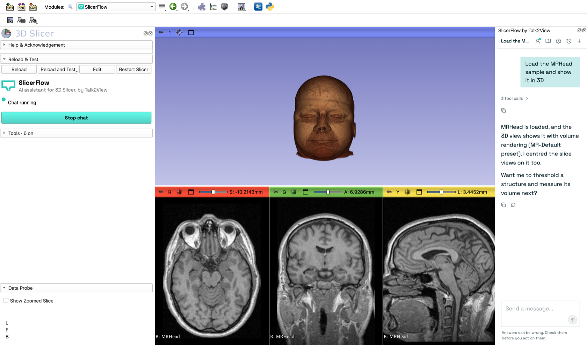

# SlicerFlow

SlicerFlow adds an AI assistant to [3D Slicer](https://www.slicer.org): chat with it in a
panel beside your views, and it looks at and changes your scene for you. It loads data,
sets layouts and views, thresholds and measures segments, places markups and, when you
allow it, looks at a screenshot of a view.

SlicerFlow has one module, **SlicerFlow** (**Modules → Talk2View → SlicerFlow**): it
starts and stops the chat and lists the assistant's tools, which you can switch off or
extend with your own. The chat itself is in the **SlicerFlow by Talk2View** panel on the
right of the window.

- **Needs:** 3D Slicer 5.12 or newer, and the internet. The assistant runs on
  [Talk2View](https://talk2view.com)'s online service: chat as a guest within Talk2View's
  guest limits, or sign in with a free Talk2View account.
- **Your data:** nothing is sent until you press **Start chat**. Once you do, what you type
  or dictate goes to Talk2View and the AI models it uses to answer, together with what the
  assistant's tools find in your scene: the names of what is loaded (a volume loaded from
  DICOM is often named after the patient), sizes, spacing, value ranges, segment names and
  measurements, and any screenshot you approve. The descriptions of the tools and skills
  the assistant can use, your own included, are sent too. The image data itself never
  leaves your computer except in a screenshot you approve. See the
  [Talk2View privacy policy](https://talk2view.com/legal/privacy-policy).
- **Not for clinical use.** SlicerFlow is for research and education. Answers can be
  wrong: check them before you act on them.
- **License:** MIT (`LICENSE.txt`). The bundled Space Grotesk fonts are under the SIL Open
  Font License 1.1 (`SlicerFlow/Resources/Fonts/OFL.txt`).

Install it from Slicer's **Extensions Manager** (search for SlicerFlow), restart Slicer and
press **Start chat** in the panel on the right. Try *"Load the MRHead sample and show it in
3D"*, *"Threshold the bone and tell me its volume"*, or *"Take a screenshot of the 3D view
and tell me what you see"*.

Developing SlicerFlow, running its tests or building on it: see
[DEVELOPING.md](DEVELOPING.md).

## The chat panel

The chat lives in the **SlicerFlow by Talk2View** panel on the right, apart from the module
panel on the left, so it stays in view whichever module you work in.

**Nothing is sent until you start it.** The first time Slicer starts with SlicerFlow, the
panel says what the chat sends and offers **Start chat**: until you press it, SlicerFlow
installs nothing and contacts nothing. Pressing it is your opt-in, and Slicer remembers it:
from then on the chat starts by itself when Slicer starts. Slicer's startup never installs
a package, though: when an update of SlicerFlow needs a newer Talk2View SDK, the panel asks
you to press **Start chat** to install it.

- Close the panel with its close button; the chat keeps running. **View → SlicerFlow by
  Talk2View** shows it again, and so does pressing **Start chat** in the SlicerFlow
  module. Slicer remembers whether the panel was open and opens it (or not) the same way
  at the next start. A closed panel starts the chat the first time you show it.
- A line at the top of the panel says what the chat page cannot: the SDK being
  installed, the chat open in another 3D Slicer window, an engine that could not be
  reached, or why the chat did not start, with a button that helps (**Start chat**,
  **Try again**, **Remove the lock and start**). The engine line clears itself as soon as
  the engine answers or someone signs in; its **Try again** checks again without
  restarting the chat.
- The SlicerFlow module (**Modules → Talk2View → SlicerFlow**) keeps **Start chat** /
  **Stop chat** and the status line.
- Your first **Start chat** installs the Talk2View SDK (`talk2view==0.5.1`) and `httpx`
  from PyPI into Slicer's Python, with Slicer's own progress window.
- The chat never starts by itself before your first **Start chat**, in Slicer's `--testing` mode, in a scripted or
  windowless run (`--python-script`, `--python-code`, `--exit-after-startup`,
  `--no-main-window`), or when the environment variable `SLICERFLOW_NO_AUTOSTART` is set
  (to anything but `0`). The panel then says "Chat stopped." (or, before your first start,
  what the chat sends) with a **Start chat** button.
- Turn timings are logged to `metrics.jsonl` in `<Slicer settings folder>/Talk2View/`, for
  looking into a slow chat (one line per message: no message text, tool arguments or
  results; it rotates at 1 MB, keeping one `metrics.jsonl.1`). It stays on your computer.

## Microphone

Dictation records with the computer's microphone, in Slicer's Python (`sounddevice`,
installed the first time the chat starts, except where the mic cannot work), and the
Talk2View engine transcribes it. The mic button shows only where recording can work:

- **Windows and Linux**: a microphone must be present (Linux also needs the system's
  PortAudio: `sudo apt install libportaudio2`). Windows asks for permission the first time.
- **macOS**: the official Slicer.app carries no `NSMicrophoneUsageDescription` in its
  `Info.plist`, so macOS cannot ask for permission on its behalf -- the microphone is
  unusable there either way, whether that means a device that silently delivers zeros
  forever or the crash a process without that key is documented to get. SlicerFlow
  therefore never touches it on macOS, and shows no mic button, until a Slicer build
  declares the key. (`Testing/Python/test_audio_probe.py` runs a raw open in a *child*
  process of Slicer's own bundled Python, so it cannot take this suite down either way, and
  records what happened; a child process cannot say for certain which of the two this
  Slicer actually gets: see "Verifying the microphone on a real macOS launch" in
  [DEVELOPING.md](DEVELOPING.md).)
- If the mic button shows but nothing is heard, check the app's permission in the
  system's privacy settings.

## What it can do

The tools come in packs: Scene & data, Views, Volumes, Segmentation, Markups and
Screenshots. They are all on; switch any of them off under **Tools** in the module panel
(the assistant then works without them, and with every pack off it can only answer in
text).

The tools marked "asks first" wait for your approval in the chat before they run, and each
of them **asks every time**. There is no "always allow" in SlicerFlow: one approval is one
call, never a standing permission for the rest of the conversation. The chat does not offer
the button, and an "always" is refused even when something else asks for one.

| Tool | What it does |
|---|---|
| `get_scene_context` | Lists the volumes, segmentations, models and markups, the layout and where each slice view is |
| `list_sample_data` | Lists Slicer's sample data sets |
| `load_sample_data` (asks first) | Downloads and loads a sample data set. **3D Slicer stops responding while it downloads** — a minute or so the first time a sample is fetched, then it comes from the cache. There is no progress and no way to stop it |
| `load_file` (asks first) | Loads a volume, segmentation, model or markups file from your computer (not scenes or DICOM folders). The card names the path: check it is the one you mean |
| `set_layout` | conventional, four-up, 3d-only, red-only, yellow-only, green-only, dual-3d |
| `navigate_slice` | Moves a slice view to an offset, or by an amount |
| `center_views` | Resets the slice and 3D views |
| `set_window_level` | Window/level of a volume |
| `set_volume_rendering` | Shows or hides volume rendering, with an optional preset |
| `set_segment_display` | Shows or hides segments, and sets their opacity or color |
| `threshold_segment` (asks first) | Makes a segment from a value range; replaces a segment with the same name |
| `measure_segment_volumes` | Measures segment volumes in cm³ |
| `add_markup_point` | Adds a point markup |
| `capture_view` (asks first) | Takes a screenshot of a view for the assistant to look at (see below) |

No SlicerFlow tool runs Python code, clears the scene or saves files. Your own tools
(below) do whatever their code does.

Try: *"Load the MRHead sample and show it in 3D"*, *"Threshold the bone and tell me its
volume"*, or *"Take a screenshot of the 3D view and tell me what you see"*.

### Screenshots

The engine takes images only in your messages, not in a tool's answer. So after a reply
in which the assistant used `capture_view`, SlicerFlow sends one more message for you,
"(Sent by SlicerFlow) The screenshots capture_view took: …", with the images attached,
and the assistant answers it. It is not sent if you press Stop, start a new chat, the
reply ends with an error, or the signed-in account changes before it goes out. Stop
cannot call back an image that is already being uploaded, though: the message is not
sent, but that screenshot has reached the Talk2View server. A screenshot leaves your
computer. The corner text of slice views can show patient details, which is why
`capture_view` asks first, every single time. Looking at images needs a model that supports
them.

## Your account

Chat as a guest, or sign in with your Talk2View account in the chat, with your email and
password. Forgot it? The chat's link opens https://talk2view.com/reset-password.

- **Guests.** Without an account you can start chatting straight away: your first
  message starts a guest session, as on the Talk2View website. Nothing is created before
  you send one. Guests get what the partner's guest limits allow. When a guest's
  allowance runs out, the chat shows the sign-in form with "You’ve reached the guest
  limit. Sign in or create a free account to keep going." When Talk2View does not start a
  guest at all (guests off for this app, the day's guest cap reached, or a captcha this
  app cannot show), the first message brings up the sign-in form with "Guest chat isn’t
  available right now. Sign in to keep going.", which does not say which of those it is.
  Sign in or create an account from the chat's account button at any time.
- **You stay the same guest.** Like the Talk2View website, SlicerFlow keeps a guest
  session on this computer, so the next time you open Slicer you carry on as the same
  guest, with the same allowance. On a shared computer, the next person to open Slicer
  does too, until someone signs in with an account from the chat's account button.
- **Sign in with Apple or Google** opens your web browser, which asks you to confirm that an
  app on this computer is signing you in, then sends you back to Slicer. The browser has to
  run on the same computer as Slicer: over remote desktop, sign in with email and password.
- **New chat** keeps the conversation in the chat's list (**Chats**) on this computer and
  starts another.
- **One chat at a time per user account.** Starting a chat takes a lock at
  `<Slicer settings folder>/Talk2View/chat.lock`, next to the sign-in (`auth.json`) it
  protects and the chat's own list (`conversations.json`, kept separate from the sign-in
  so a reply does not rewrite the file a refresh also rewrites): the Talk2View server
  rotates the refresh token on every renewal, so two Slicer
  processes sharing one sign-in would sign each other out. The settings folder is per user
  account, so it is that sign-in the lock covers — two people logged in to one computer
  under their own accounts each get their own chat. A second chat in your account is
  refused ("The SlicerFlow chat is already open in another 3D Slicer window on this
  computer…"), and that lock is never removed for you. If the lock instead names
  another computer that shares this home directory (a roaming or network profile),
  SlicerFlow cannot tell by itself whether that chat is still running, so it never
  removes the lock by itself: the chat panel's status line offers a **Remove the lock and
  start** button instead. If that chat is still live, the removal is refused either way,
  so a running chat is never cut loose by mistake.

## Partner key

The extension ships its Talk2View partner key in `SlicerFlow/Resources/partner.json`.
A partner key names the app to Talk2View. It is not a password: every request also needs
your own sign-in, and web pages that use Talk2View carry their key in the page too. So
nobody has to type one: the key is in the file already, so the chat works out of the box.

That key belongs to SlicerFlow's own partner, "3D Slicer", in the Talk2View dashboard:
it can be rotated on its own, its usage is SlicerFlow's alone, and its guest limits
(set in the dashboard) cover only SlicerFlow users. Swapping it is a one-line change to
`partner.json`. Treat the file as public: it
ships to every user, so never put anything secret in it.

To use another partner key or engine (developers, or a partner building on SlicerFlow),
set the environment variables `T2V_PARTNER_KEY` / `T2V_BASE_URL` before starting Slicer.
The environment wins over `partner.json`; there is no module panel field for either any
more. The engine URL must be `https://` (plain `http://` only for `127.0.0.1` or
`localhost`).

## Skills

Skills are notes the assistant reads when a request needs them, in the
[Agent Skills](https://agentskills.io/specification) format: a folder holding
`SKILL.md`, with `name` and `description` frontmatter, then instructions in Markdown.
SlicerFlow ships four, read-only, in `SlicerFlow/Resources/Skills/`: CT window presets,
segmenting by threshold, measuring and reporting volumes, and exploring the sample data.

Manage your own in the chat's **Skills** view (the sparkles button in the chat header):
write one there, ask the assistant to "save this as a skill" after it does something
useful, or **Import** a `.md` file or a skill folder from your computer (SlicerFlow
shows its own file/folder picker for that). The view also lets you edit, customize a
bundled skill (which copies it to your own folder for editing), turn a skill on or off,
and delete one. Your skills live at `<Slicer settings folder>/Talk2View/skills/`, one
folder per skill, `<name>/SKILL.md` (the folder's `README.txt` shows the format); a skill
of yours with the same name as a bundled one replaces it.

## Your own tools

Every tool pack is a Python file in `<Slicer settings folder>/Talk2View/tools/`,
SlicerFlow's own packs included: it writes them there as `slicerflow_scene.py`,
`slicerflow_view.py` and so on, so you can read them, copy from them and change them. Your
own packs are the other `.py` files in that folder, one per **tool pack**. A pack is
functions with the Talk2View SDK's `@tool` decorator, listed in `TOOLS`, with an optional
`TITLE` the panel shows instead of the file's name. Each function's signature and docstring
are what the assistant sees.

Manage them in the SlicerFlow module panel, under **Tools**. The list shows every pack with
who it is from (SlicerFlow, Edited or Yours) and its status. Select one to see its tools
(what each does, and which ask first), its file, **Open in editor** (a text editor, never a
run of the file) and **Show in folder**. **New…** writes a commented example and opens it,
**Import…** copies a `.py` file in, and a pack's box turns it on or off. A pack runs inside
3D Slicer with full access to your scene and your files, so turning one on (or importing
one) asks first. Changes load when the chat restarts: press **Restart chat** in the bar
that appears.

SlicerFlow keeps its own packs current: when SlicerFlow updates, so do its files, unless
you edited one. An edited file is yours from then on: it is marked **Edited**, SlicerFlow
never overwrites it, and it is off until you turn it on (which asks first, like your own
packs). Its tools keep the approvals their file declares (each of SlicerFlow's says
`permission=True` or `permission=False`); a tool you add without `permission=False` asks
first. **Restore original** puts SlicerFlow's version back and keeps yours beside it as
`.py.bak`. Deleting one of SlicerFlow's files only makes it come back; to stop using a
pack, switch it off.

- Each of your tools asks for your approval before every call, like SlicerFlow's own
  tools that ask; there is no "always allow". `@tool(permission=False)` runs a tool
  without asking. Use it only for a tool that reads and never changes anything.
- A pack that fails to load shows its error in the panel, and the chat starts without
  it. The same happens to a pack that reuses a tool name: SlicerFlow's tools come first,
  then your packs in name order.
- Packages Slicer does not have go in `REQUIRES = {"import name": "pip package"}`. The
  panel shows "needs …", and **Install packages** installs them into Slicer's Python.
  Slicer stops responding until pip finishes.
- Tools run on Slicer's main thread, so Slicer stops responding until one returns. Never
  call `slicer.app.processEvents()` in one, and don't use
  `from __future__ import annotations`.
- With more than 30 tools in a chat, the assistant chooses among them less reliably. The
  panel tells you when you reach that.

## Upgrading from Talk2Slicer

SlicerFlow used to be called Talk2Slicer. Nothing is lost when you upgrade: the sign-in,
chats and skills stay in `<Slicer settings folder>/Talk2View/`, and the first start copies
the partner key, engine URL and whether the panel was shown from the `Talk2Slicer/`
settings, once, never over a value SlicerFlow already has (the old settings stay, for an
older build). The old environment variables `TALK2SLICER_HOME` and
`TALK2SLICER_NO_AUTOSTART` still work when `SLICERFLOW_HOME` and `SLICERFLOW_NO_AUTOSTART`
are unset.
